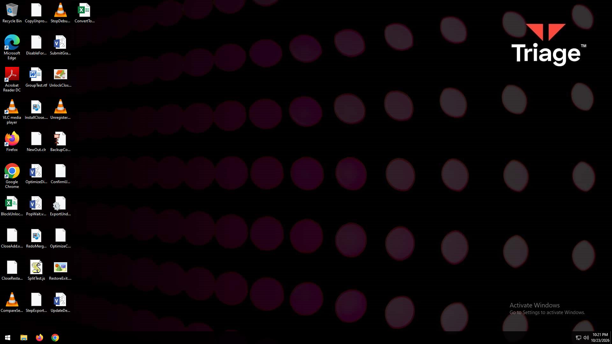
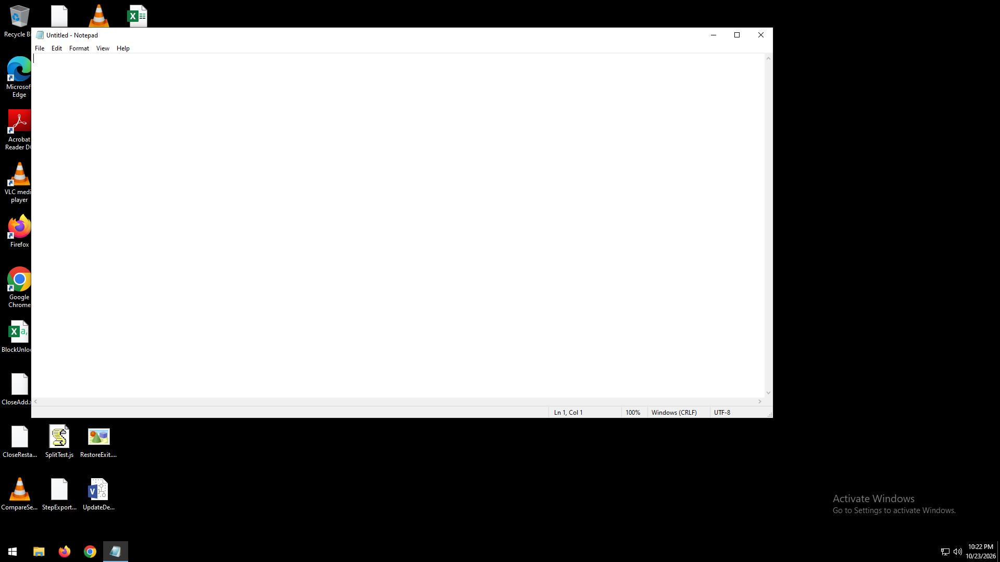

# Unpack the PCAP: NanoCore
## Screen Exfiltration — the Rat That Filmed Its Own Jail

<!--
- Welcome back to Unpack the PCAP. I'm Keith. Let's crack open another PCAP.
- Today: a NanoCore RAT, October 23rd, 2026, and its screenshots — five of them.
- The malware POSTed real 1920x1080 screenshots back to its C2, in plaintext HTTP.
- We are going to carve every single one of them out of the capture and look at what the attacker bought.
- JOKE: It's like a pet cam aimed at a hamster that won't run in the wheel — and it still snaps a picture every thirty seconds, right on schedule.
-->

---
layout: center
---

## Get these interactive slides at

# https://www.UnpackThePCAP.com

<!--
- The interactive version of this deck is live — every query here is copy-pasteable against our logs.
- JOKE: Yes, I'm asking you to paste code from a cybersecurity video into a terminal. Every scam opens with that exact line — ours just comes with slides.
- Every query runs against our own logs — take one for a spin whenever you like. First things first, though: where did this capture come from?
-->

---

## Source & Attribution

| What | Detail |
|---|---|
| PCAP + analysis report | [Triage — 261023-z7bl2svw4m](https://tria.ge/261023-z7bl2svw4m) |
| Sample | sha256 `1fbc51e3ea9cb43adf4cec5f03b4dcff8ed5139dc0aa5a728b8b54f61acbd7cd` |
| Capture | 2026-10-23, 21:21–21:23 UTC · 2,244 packets |

**Everything else is derived from that PCAP, in this deck:** Zeek logs in `output/` · WHOIS + GeoIP for the IPs

<!--
- Before we start: every claim in this deck comes from publicly available sources.
- One actual source: the Triage sandbox — PCAP and analysis report — sample ID 261023-z7bl2svw4m, link on the slide.
- To pull the PCAP yourself: open the analysis link → the behavioral1 task → Download → PCAPNG — a Triage account covers this and the report JSON alike, and every Zeek, tshark and capinfos command in this deck runs against that file.
- Everything else — every count, every IP, every timestamp — we derive together from that PCAP: Zeek logs we generate ourselves.
- Per the published analysis and per the PCAP — if it's on a slide, there's a command behind it.
- JOKE: It's all public. Somebody did the crime, and I show up afterward with a microphone and a presentation nobody asked for.
- Source lined up — now let's talk about the shape of this capture.
-->

---

## Outline

| | |
|---|---|
| 1. Source & Attribution | 6. Act 4 — TLS & DNS |
| 2. Traffic Overview | 7. Detection & IOCs |
| 3. Act 1 — meet the dropper | 8. Key Takeaways |
| 4. Act 2 — three messages, all in the clear | |
| 5. Act 3 — carve the screenshots | |

<!--
- Eight sections, in the order the investigation actually happened.
- We start with the toolchain and the victim, follow the dropper into its plaintext C2 channel.
- Then the main event: carving the exfiltrated screenshots straight out of the PCAP.
- After that: the TLS side channel, then the detection work — closing out with the indicators and the takeaways.
- JOKE: The outline of every episode is the same — traffic, malware, shame, a Zeek script. This one adds a photo album.
- Let's fire up Zeek.
-->

---

## How these logs were made

```
$ zeek -C -r \
    pcaps/nanocore_261023-z7bl2svw4m/nanocore_261023-z7bl2svw4m.pcapng \
    Log::default_logdir=output \
    ja4 log-add-http-post-bodies zeek-log-all-http-headers
$ ls output/*.log
output/conn.log
output/dns.log
output/files.log
output/http.log
output/ocsp.log
output/packet_filter.log
output/ssl.log
output/x509.log
```

<!--
- Here's the command that generated every Zeek log this episode uses — plain Zeek, nothing to explain but the three packages riding along.
- First grab the PCAP itself — report page → behavioral1 task → Download → PCAPNG — this command reads it from pcaps/ right where we left it.
- Want the full default log set too — software.log, notice.log? Add `local`: `zeek -C -r <pcap> local packages`. Our output/ is the leaner run; those two logs only appear with the scripts loaded.
- The packages: ja4 fingerprints TLS clients, zeek-log-all-http-headers keeps every header, and log-add-http-post-bodies writes POST bodies into http.log.
- That last one is load-bearing — without it, this capture is just a guy POSTing at a server and us guessing what's inside.
- ls shows the eight logs — http.log is where the entire C2 protocol will show up.
- JOKE: log-add-http-post-bodies is the only reason this episode exists. Without it we'd be doing a dramatic reading of TCP.
- Logs exist — now we need a way to query them that doesn't make you cry.
-->

---

## DuckDB Setup

```
$ duckdb -c "FORCE INSTALL zeek FROM community; FORCE INSTALL inet;"
```

- **`zeek`** — by [Yacin Nadji](https://github.com/ynadji/zeek-duckdb) — adds `read_zeek()`, reads Zeek TSV logs directly
- **`inet`** — IP address column types (`id_orig_h <<= '10.127.0.0/16'` etc.)
- Every query from here on starts with `LOAD zeek; LOAD inet;` — both packages, every session
- Repo: [github.com/ynadji/zeek-duckdb](https://github.com/ynadji/zeek-duckdb)

<!--
- One install command and you've got the whole toolchain.
- The zeek extension is Yacin Nadji's work — it gives DuckDB a read_zeek() function that eats Zeek TSV logs directly, no zeek-cut, no awk, no shell plumbing.
- inet gives you real IP types — CIDR matching with <<=, comparisons that don't lie.
- Every query you'll see next is one readable statement with LOAD zeek; LOAD inet; at the top.
- JOKE: We FORCE INSTALL from a community repo to dodge writing one awk script. Peak 2026.
- Toolchain set — time to find the victim.
-->

---

## Who's the victim?

```
$ duckdb -box -c "LOAD zeek; LOAD inet;
SELECT id_orig_h, count(*) AS conns
FROM read_zeek('output/conn.log')
GROUP BY 1 ORDER BY 2 DESC;"
┌─────────────┬───────┐
│  id_orig_h  │ conns │
├─────────────┼───────┤
│ 10.127.0.22 │ 63    │
│ 10.127.0.1  │ 1     │
└─────────────┴───────┘
```

<!--
- Who's the victim? Per the PCAP, the answer is 10.127.0.22 — 63 of the 64 connections in the capture start there.
- The lone 10.127.0.1 row is one service-less flow into the victim — not part of the story.
- The hostname turns up later, smuggled inside the POST bodies: OPSJLZUQ.
- JOKE: The victim's hostname is OPSJLZUQ — it reads like a license plate issued by a machine that gave up on naming halfway through.
- That's a sandbox machine, and in a few minutes we're going to watch it get photographed against its will.
- JOKE: 10.127.0.22 is private address space — the network's version of an unlisted number. The victim can't be reached for comment.
- One victim, one IP — now let's measure the crime scene.
-->

---

## The capture in numbers

```
$ P=pcaps/nanocore_261023-z7bl2svw4m/nanocore_261023-z7bl2svw4m.pcapng
$ TZ=UTC capinfos -c -s -d -a -e $P
File name:           pcaps/nanocore_261023-z7bl2svw4m/nanocore_261023-z7bl2svw4m.pcapng
Number of packets:   2244
File size:           1580 kB
Data size:           1500 kB
Earliest packet time: 2026-10-23 21:21:06.501049000
Latest packet time:   2026-10-23 21:23:32.481147000
```

<!--
- The whole capture: 2,244 packets, 1.5 megabytes, about two and a half minutes of wall clock.
- TZ=UTC keeps every machine honest — these timestamps are the same ones the rest of the deck uses, no conversion to forget.
- capinfos ships with Wireshark's command-line tools: wireshark-common on Debian, brew's wireshark on a Mac.
- Two and a half minutes is all we get — and five screenshots get POSTed back to the C2 inside that window.
- JOKE: Nine background requests from Windows and nobody blinked. The malware sent five screenshots and caught a case.
- JOKE: The malware weighs 58 kilobytes and shipped home seven times its own body weight in screenshots. That's not exfiltration — that's a hernia.
- We know how big it is — what's actually inside it?
-->

---

## Protocol breakdown

```
$ duckdb -box -c "LOAD zeek; LOAD inet;
SELECT coalesce(nullif(service,''),'(none)') AS service,
       count(*) AS conns, sum(orig_bytes+resp_bytes) AS bytes
FROM read_zeek('output/conn.log') GROUP BY 1 ORDER BY 2 DESC;"
┌─────────┬───────┬────────┐
│ service │ conns │ bytes  │
├─────────┼───────┼────────┤
│ ssl     │ 34    │ 402781 │
│ dns     │ 19    │ 4274   │
│ http    │ 7     │ 938037 │
│ (none)  │ 4     │ 8220   │
└─────────┴───────┴────────┘
```

<!--
- The service breakdown tells you where to look before you read a single packet.
- SSL dominates by connection count — 34 — that's the malware's TLS sessions plus the sandbox's own Windows chatter.
- HTTP is only 7 connections but carries 938,037 bytes — the largest byte total by far. The exfil lives there.
- And four service-less connections — three dead attempts to an IP that never answers, plus one ICMP error from 10.127.0.1.
- JOKE: The malware moved 547 kilobytes of payload past Windows Update's 262 — better than two to one. Nobody, not even Windows Update, outworks a background job with a deadline.
- Counts are nice — that's the shape of the traffic, and HTTP's bytes are where the exfil lives.
- Now let's meet the thing that generated it: the dropper itself.
-->


---

## Act 1 — meet the dropper

```
$ P=https://tria.ge/api/v0/samples/261023-z7bl2svw4m/overview.json
$ curl -s -H "Authorization: Bearer YOUR_TOKEN" "$P" -o triage.json
$ python3 -c "
import json
d = json.load(open('triage.json'))
for s in d['signatures']:
    if (s.get('score') or 0) >= 9:
        print(s['score'], s['name'])"
10 Contains code to disable Windows Defender
10 Family: NanoCore
10 Modifies Windows Defender DisableAntiSpyware settings
10 Modifies security service
9 Deletes shadow copies
```

- Config extracted by Triage: **NanoCore RAT**, version `1.2.2.0`, group `xoilac` — a [leaked build](https://blog.talosintelligence.com/nanocore-netwire-and-asyncrat-spreading/) per Cisco Talos

<!--
- Who's behind the traffic? The sample went into the Triage sandbox, the dropper ran for real, and this report is the scorecard of that run — here are its top scores.
- To run this block yourself: a free tria.ge account, then your token from the Account page's API access section — the curl on screen downloads the same overview.json this block reads.
- Reading needs no account at all — the full report is in the browser at the source link; only the JSON download wants a token.
- Score 10 across the board: disables Windows Defender, family NanoCore, kills the security service — and at 9, deletes shadow copies.
- This is the compliance checklist of a malware author: everything that could notice him, switched off first.
- Version 1.2.2.0 matters — per Cisco Talos's campaign writeup, that build is the leaked one. The link's on the slide.
- JOKE: The victim graded its own attacker: tens across the board but one — and the only course this malware aces is Destruction 101.
- The report gives us the label — let's read the config itself.
-->

---

## The config

```
$ python3 -c "
import json
a = json.load(open('triage.json'))['extracted'][0]['config']['attr']
for k in sorted(a):
    print(k + ':', a[k])"
c2_url: http://socolivetv-tv.com
default_group: xoilac
primary_dns: ali.ns.cloudflare.com
secondary_dns: woz.ns.cloudflare.com
version: 1.2.2.0
```

- NanoCore 1.2.2.0 first leaked in [March 2015](https://www.helpnetsecurity.com/2015/03/24/full-cracked-version-of-nanocore-rat-leaked-onslaught-of-infection-attempts-expected/) — this campaign runs nine-year-old source code

<!--
- Here's the extracted config, straight out of the triage.json we just downloaded — the C2 URL in plaintext, the group name, Cloudflare's name-servers, and the version.
- c2_url is http — note the scheme. Plain HTTP. That's the whole ballgame for the next two sections.
- Version 1.2.2.0 — the source for that build leaked in March 2015. This 2026 campaign is running nine-year-old code.
- JOKE: Try reading c2_url out loud: socolivetv-tv. You'll stutter — this address is already buffering.
- Config says NanoCore — and version 1.2.2.0 has one very unusual property for malware: the source is out in the open.
- Where exactly? That gets its own slide — links and all.
-->

---

## The source is public

- [bridDev/NanoCore-1.2.2.0](https://github.com/bridDev/NanoCore-1.2.2.0) — the leaked build itself: builder + plugins in one `.rar`
- [pmadder/NanoCore-Rat](https://github.com/pmadder/NanoCore-Rat) — same build; README: "Cracked By Alcatraz3222" (archive password `123`)
- [w1u0u1/NanoCore](https://github.com/w1u0u1/NanoCore) — the stub client's source (16 `.cs` files) — where we went looking for our wire markers
- [nict-csl/NanoCoreRAT-Analysis](https://github.com/nict-csl/NanoCoreRAT-Analysis) — analysis tooling — and like everything else on this slide: read it, don't run it
- Leak status per [Cisco Talos](https://blog.talosintelligence.com/nanocore-netwire-and-asyncrat-spreading/): 1.2.2.0 is "a leaked version"

<!--
- The best thing about NanoCore in 2026: you don't have to wonder what it looks like inside. The 1.2.2.0 build our config just named is sitting on GitHub right now — all four links on the slide.
- Two repos host the cracked distribution — builder, plugins, the works. One README literally reads "Cracked By Alcatraz3222," archive password 123. Forget security through obscurity — this is security through not really trying.
- The third is the stub's source — where we went looking for our wire markers: SCREEN:, FAST_BEACON:, HEARTBEAT: — zero hits. The controls (socket, command, connect) lit up 131 times. So the labels aren't NanoCore's at all — the operators' own code bolts an HTTP channel onto the RAT and hard-codes a marker into every POST body.
- Fourth is analysis tooling — and to be explicit for anyone replaying this at home: all four links are reading material. We don't run code out of these repos — hashes, metadata, source as text; that's the whole method. And Talos is our source for the leak status itself.
- JOKE: This distribution's README advises you to disable your antivirus before use. Warranty void if safety equipment is used — and somewhere, operators are standing by, waiting for you to turn it off.
- That's the ecosystem — now, what does OUR copy actually say on the wire? The POSTs.
-->

---

## Act 2 — three messages, all in the clear

```
$ duckdb -box -c "LOAD zeek; LOAD inet;
  SELECT split_part(post_body,':',1) || ':' AS message,
         count(*) AS count, min(request_body_len) AS min_bytes,
         max(request_body_len) AS max_bytes
  FROM read_zeek('output/http.log')
  WHERE method='POST' GROUP BY 1 ORDER BY 2 DESC;"
┌──────────────┬───────┬───────────┬───────────┐
│   message    │ count │ min_bytes │ max_bytes │
├──────────────┼───────┼───────────┼───────────┤
│ FAST_BEACON: │ 14    │ 20        │ 20        │
│ SCREEN:      │ 5     │ 99507     │ 144619    │
│ HEARTBEAT:   │ 4     │ 24        │ 24        │
└──────────────┴───────┴───────────┴───────────┘
```

<!--
- The entire C2 protocol is three message types, typed into the body of a POST.
- Read the columns straight across: message is the uppercase label that opens each POST body, count is how many times we found it, and min_bytes and max_bytes are the shortest and longest actual body size. We pull those from request_body_len — the length of the real body — not from the post_body text column, which the log caps.
- FAST_BEACON appears 14 times at exactly 20 bytes — FAST_BEACON:OPSJLZUQ.
- HEARTBEAT four times at 24 bytes — HEARTBEAT:OPSJLZUQ|Admin: the victim's hostname again, plus a label after the pipe — session, group, or role, nobody's pinned it down — all of it in the clear.
- And SCREEN, five times — 99,507 to 144,619 bytes: the first screenshot is the fat one, the other four cluster just under a hundred kilobytes. Big size gap between one and the rest, visible before we decode a single image.
- They decode straight into the JPEGs we carve in the next act.
- JOKE: Eighteen check-ins — fourteen beacons, four heartbeats — and only five photographs to show for it. This malware spends more breath saying hello than it does working.
- So we know the messages — what does the server say back?
-->

---

## Every offer refused

```
$ duckdb -box -c "LOAD zeek; LOAD inet;
  SELECT status_code, count(*) AS count,
         regexp_extract(min(server_header_values::VARCHAR),
                        '(https://[^'', ]+)', 1) AS location
  FROM read_zeek('output/http.log')
  WHERE status_code=301 GROUP BY 1;"
┌─────────────┬───────┬────────────────────────────┐
│ status_code │ count │          location          │
├─────────────┼───────┼────────────────────────────┤
│ 301         │ 23    │ https://socolivetv-tv.com/ │
└─────────────┴───────┴────────────────────────────┘
```

<!--
- What does the server say back? Twenty-three requests, twenty-three answers: 301 Moved Permanently, Location: https://socolivetv-tv.com/ — HTTPS, offered politely, every single time.
- Cloudflare fronts this domain, and Cloudflare is doing the attacker's operational security for free — and the attacker won't take it.
- The malware POSTs again over the same plaintext connection and ignores the redirect 23 times out of 23.
- Keep this slide in your head for the takeaways: a redirect is an offer, not enforcement. Servers can offer; clients don't have to listen.
- JOKE: The encryption is offered like a mint on the pillow — and the malware checks out carrying the postcard with its crime scene on the front.
- The server's fine — let's look at how the client identifies itself.
-->

---

## The User-Agent

```
$ duckdb -box -c "LOAD zeek; LOAD inet;
  SELECT user_agent, count(*) AS posts
  FROM read_zeek('output/http.log') WHERE method='POST' GROUP BY 1;"
┌──────────────────────────────────────────────────────────────┬───────┐
│                          user_agent                          │ posts │
├──────────────────────────────────────────────────────────────┼───────┤
│ Mozilla/5.0 (Windows NT 10.0; Win64; x64) AppleWebKit/537.36 │ 23    │
└──────────────────────────────────────────────────────────────┴───────┘
```

- For contrast, a real browser UA: `Mozilla/5.0 (Windows NT 10.0; Win64; x64) AppleWebKit/537.36 (KHTML, like Gecko) Chrome/156.0.0.0 Safari/537.36` — everything after `537.36` is exactly what's missing in the row above.

<!--
- All 23 POSTs share one User-Agent, and it stops mid-sentence.
- Mozilla/5.0, Windows 10, 64-bit — all correct, all boring — and then AppleWebKit/537.36, and nothing. No (KHTML, like Gecko), no Chrome, no Safari tail — the sentence just stops.
- Compare it to the real one on the slide: everything after 537.36 — the Gecko tag, the Chrome version, Safari/537.36 — is what this string never had.
- And the stacked brands in the real one are genuinely real: every browser UA wears Mozilla, WebKit and Safari tokens — added, per MDN, "for compatibility" — then its own name. Chrome/156.0.0.0 is current stable, per Chrome's release blog.
- The framework doesn't default it — Microsoft's docs put UserAgent at null, and their request library ships no UA string of its own. So when this string shows up, somebody's code chose it.
- And Microsoft treats it as familiar: their http-logging docs use this exact half-string as the example client header, Kestrel's benchmarks parse requests carrying it, and HttpClient's tests set it deliberately — known in the .NET world, origin unproven.
- JOKE: It's a police sketch that stops at the forehead. Sixty percent of a browser user agent, submitted with confidence.
- One UA for everything — but the headers underneath wobble. Here's how Zeek fingerprints them.
-->

---

## The HTTP fingerprint — ja4h

```
$ duckdb -box -c "LOAD zeek; LOAD inet;
  SELECT ja4h, count(*) AS posts
  FROM read_zeek('output/http.log') WHERE method='POST' GROUP BY 1
  ORDER BY 2 DESC;"
┌─────────────────────────────────────────────────────┬───────┐
│                        ja4h                         │ posts │
├─────────────────────────────────────────────────────┼───────┤
│ po11nn040000_d157cf9277e4_000000000000_000000000000 │ 22    │
│ po11nn050000_2381aa9b06cd_000000000000_000000000000 │ 1     │
└─────────────────────────────────────────────────────┴───────┘

```

- How to read it: [FoxIO's JA4H documentation](https://foxio.io/blog/ja4-network-fingerprinting) — `a_b_c`: application/method fingerprint · header-set hash · cookie fingerprint.

<!--
- ja4h is the HTTP fingerprint — the request-header sibling of the TLS JA4 we'll meet properly in Act 4.
- How to read it, per FoxIO's format: the a-part opens with method and version — `po11` is POST over HTTP/1.1, and our own logs agree: every GET in this capture reads `ge11`.
- The count is proven, not assumed: tshark shows the first SCREEN POST at 21:21:13 carrying five header lines — it adds Connection: Keep-Alive — and its fingerprint reads 05; every later POST carries four and reads 04. So `04` = four request headers, and the middle chunk hashes that header list — identical across all 22 because the list never changes.
- The trailing zeroes are JA4H's cookie fingerprint — zero because these POSTs send no Cookie header at all.
- JOKE: The whole identity shift is one number — 04 to 05. The Oxford comma of malware fingerprints.
- Headers catalogued — now let's go find those screenshots in the logs.
-->

---

## SCREEN: found — but truncated

```
$ duckdb -box -c "LOAD zeek; LOAD inet;
  SELECT strftime(ts AT TIME ZONE 'UTC','%H:%M:%S.%f') AS utc,
         length(post_body) AS logged_b, md5(post_body) AS body_md5_8
  FROM read_zeek('output/http.log')
  WHERE starts_with(post_body,'SCREEN:') ORDER BY ts;"
┌─────────────────┬──────────┬──────────────────────────────────┐
│       utc       │ logged_b │            body_md5_8            │
├─────────────────┼──────────┼──────────────────────────────────┤
│ 21:21:13.573460 │ 203      │ 29637e7c1e564b576963f4759aa138b6 │
│ 21:21:44.968571 │ 203      │ 29637e7c1e564b576963f4759aa138b6 │
│ 21:22:15.770728 │ 203      │ 29637e7c1e564b576963f4759aa138b6 │
│ 21:22:46.076233 │ 203      │ 29637e7c1e564b576963f4759aa138b6 │
│ 21:23:16.403598 │ 203      │ 29637e7c1e564b576963f4759aa138b6 │
└─────────────────┴──────────┴──────────────────────────────────┘
```

<!--
- Five SCREEN POSTs, one every 30.7 seconds, timestamped to the microsecond — that's the capture loop of the screenshot plugin.
- But http.log didn't keep those bodies whole: each logged SCREEN body is just the first 200 characters of the real one, then a literal "..." — the logging package's own setting, `http_post_body_length = 200`, does the trimming.
- We checked those 200 characters byte-for-byte against the PCAP: they're the real body's first 200, every time — and they match across all five because the JPEGs share their encoder headers. The matching md5s have a reason we can point at, not a guess.
- The log is a doorbell camera: it tells you five deliveries arrived and shows you exactly zero pixels.
- The actual JPEG data lives in the PCAP, in TCP stream 2. To get it out, we carve.
- JOKE: Five different photographs, one identical hash — the log read the first two hundred characters of each and shrugged, "close enough."
- Time to get our hands dirty — the carve pipeline, next.
-->

---

## Act 3 — carve the screenshots

```
$ ./scripts/carve.sh pcaps/nanocore_261023-z7bl2svw4m/nanocore_261023-z7bl2svw4m.pcapng images
-rw-r--r--@ 1 keith.jones  staff  108458 Oct 28 11:53 images/screen1.jpg
-rw-r--r--@ 1 keith.jones  staff   74624 Oct 28 11:53 images/screen2.jpg
-rw-r--r--@ 1 keith.jones  staff   74631 Oct 28 11:53 images/screen3.jpg
-rw-r--r--@ 1 keith.jones  staff   74631 Oct 28 11:53 images/screen4.jpg
-rw-r--r--@ 1 keith.jones  staff   74630 Oct 28 11:53 images/screen5.jpg
```

- Two arguments — **PCAP in, directory out**, nothing hardwired. Inside: Zeek’s extract analyzer (`scripts/extract_http_post.zeek`) pulls every HTTP request body, then the script decodes the `SCREEN:` ones → `screenN.jpg`

<!--
- One script, two arguments: the PCAP in, the directory out — no paths baked in, so you run it against your own copy of the capture wherever it lives.
- Under the hood it's Zeek: scripts/extract_http_post.zeek attaches the file-extract analyzer to every HTTP request body flowing client to server.
- Zeek drops each body into extract_files/ under a name like `extract-1792790473.622913-HTTP-Fky2lp1Lo0aBEmk3Fj` — the epoch timestamp, the analyzer, and Zeek's file ID. The script sorts those by timestamp, renames them screen1 through screen5, then prints their listing: the `ls -l` block on the slide is that final command's output, nothing else.
- The script keeps bodies starting with SCREEN:, strips the seven-byte prefix, and base64-decodes what's left — a JPEG, every time.
- Data files carved out of a PCAP: we display them.
- Look at the sizes: the first screenshot is 108 kilobytes, the other four are all about 74 — something changed after the first one that made the pictures simpler, then stayed that way. What it was, next.
- JOKE: The whole scheme was base64 — a lock with the key taped to the front of it.
- The files exist. Let's look at what the attacker actually bought.
-->

---

## The first screenshot



- Screenshot 1 · 21:21:13 UTC · 108,458 bytes · sandbox desktop, "Activate Windows" watermark

<!--
- This is the first screenshot, 1920 by 1080, straight out of the attacker's own exfiltration stream.
- What you're looking at is the analyst's sandbox: wallpaper, tool icons, and an Activate Windows watermark nobody bothered to clear.
- The victim never visited a website in this capture — the RAT just started photographing the desk it woke up on.
- Every 30.7 seconds, point and shoot, whether anything happened or not.
- JOKE: The analyst's fortune cookie: "A stranger will photograph your desk five times tonight."
- The first screenshot is the desktop — then the sandbox does exactly one thing for the rest of the capture. Here it is, four times.
-->

---

## Screenshots 2 through 5

<div style="display:flex;gap:8px;margin-bottom:8px"></div><div style="display:flex;gap:8px"></div>

- One empty Notepad window, opened once, photographed four times — the operator's entire return on investment

<!--
- Screenshots two through five: an empty Notepad window. Untitled, line one, column one, no characters — ever.
- The sandbox opened Notepad and sat there while the RAT dutifully shipped a photo of it home every 30 seconds.
- Four of the five stolen images are this window. The clock in the taskbar creeps 10:21 to 10:23 and that's the whole plot.
- Ninety seconds of a blank text file, base64-encoded and POSTed like it was trade secrets.
- JOKE: Somewhere an operator paid for a RAT and got a 90-second screenshot of Notepad. The most valuable intelligence here is an empty file, and both sides of the transaction are disappointed about it.
- Four photographs of the same window — let's see what the files themselves kept.
-->

---

## What metadata survives

```
$ exiftool images/screen1.jpg \
    | grep -E "JFIF|Resolution|Image Size|Color|DateTime|Software"
JFIF Version                    : 1.01
Resolution Unit                 : inches
X Resolution                    : 96
Y Resolution                    : 96
Color Components                : 3
Image Size                      : 1920x1080
```

<!--
- exiftool over all five screenshots: the box shows every format fact there is — JFIF, resolution, color, size — and the full report adds only file-system lines and JPEG geometry on top. What's absent from all five images is everything that would identify the shot: DateTime (when it was taken), Software (what took it), Make (which device made it).
- JFIF 1.01, 96 DPI, three color components, 1920x1080 — the report stops there. Zero EXIF: no EXIF segment exists in any of the five files. Per Microsoft's docs, GDI+ writes metadata only when code explicitly asks for it — a plain save writes none.
- The only timestamp inside these images is painted in pixels: the taskbar clock, 10:23 PM, 10/23/2026 — which lines up with the HTTP Date headers and Zeek's epoch once you account for the sandbox running on UTC+1.
- JOKE: None of the six lines says when the picture was taken — so we dated it the way you date a proof-of-life photo: by reading the clock in the corner.
- We have the pictures. The other half of this beacon loop rides on TLS — let's open it up and count.
-->

---

## Act 4 — TLS & DNS

```
$ duckdb -box -c "LOAD zeek; LOAD inet;
  SELECT id_resp_h, count(*) AS sessions,
         count(*) FILTER (WHERE resumed) AS resumed,
         count(*) FILTER (WHERE NOT resumed) AS full_hs
  FROM read_zeek('output/ssl.log')
  WHERE server_name='socolivetv-tv.com' GROUP BY 1 ORDER BY 2 DESC;"
┌────────────────┬──────────┬─────────┬─────────┐
│   id_resp_h    │ sessions │ resumed │ full_hs │
├────────────────┼──────────┼─────────┼─────────┤
│ 104.17.235.173 │ 20       │ 19      │ 1       │
│ 104.17.218.96  │ 3        │ 3       │ 0       │
└────────────────┴──────────┴─────────┴─────────┘
```

<!--
- 23 TLS sessions to socolivetv-tv.com — and they split across two Cloudflare addresses.
- One full handshake on the first connection, and then 22 resumed sessions — session resumption, the malware waving its already-introduced self back in.
- Then mid-capture, at the very end, three sessions land on a different Cloudflare IP — live IP rotation while we're watching.
- The TLS session timing mirrors the POST cadence — every POST lands within a second of a TLS session start. Same beacon loop, two channels, one stopwatch.
- JOKE: One full handshake, twenty-two resumes — the malware cleared security once and now it's PreCheck.
- Two addresses, one client — and one beat that ties both channels together. Watch them alternate.
-->

---

## One loop, two doors

```
$ P=pcaps/nanocore_261023-z7bl2svw4m/nanocore_261023-z7bl2svw4m.pcapng
$ tshark -r "$P" -Y 'http.request.method == "POST" && ip.dst == 104.18.86.1' \
    -T fields -e frame.time_relative -e http.request.method -e ip.dst \
    -e http.request.full_uri > /tmp/loop.txt
$ tshark -r "$P" -Y 'http.response.code == 301 && ip.src == 104.18.86.1' \
    -T fields -e frame.time_relative -e http.response.code -e ip.src \
    -e http.location >> /tmp/loop.txt
$ tshark -r "$P" -Y 'http.request.method == "GET" && http.host contains "socolivetv"' \
    -T fields -e frame.time_relative -e http.request.method -e ip.dst \
    -e http.request.full_uri >> /tmp/loop.txt
$ sort -n /tmp/loop.txt | head -6
7.422396000	POST	104.18.86.1	http://socolivetv-tv.com/
7.468916000	301	104.18.86.1	https://socolivetv-tv.com/
8.354233000	GET	104.17.235.173	https://socolivetv-tv.com/
9.381214000	POST	104.18.86.1	http://socolivetv-tv.com/
9.426860000	301	104.18.86.1	https://socolivetv-tv.com/
9.533795000	GET	104.17.235.173	https://socolivetv-tv.com/
```

- POST to :80, a 301 pointing at https, then the GET on :443 — one cycle, twenty-three times. Nineteen rounds finish inside a fifth of a second; four run longer, starting with the first.

<!--
- The order is the answer to how the channels connect: every cycle runs the same three beats — POST to port 80; about forty-five milliseconds later a 301, Location: https://socolivetv-tv.com/ (22 of 23 rounds land between 45 and 47ms, one stalled at 525); then a brand-new TLS connection opens and GETs exactly that URL.
- And the new TLS connection opens AFTER the 301 every single time — twenty-three for twenty-three — usually within a millisecond of it (16 of 23 under 1ms, median 0.82ms; the first round waits 735ms for the full handshake). That's the DIAL, though: the GET itself arrives about a tenth of a second later, once the handshake completes — that's the gap the box displays. Either way it's a program reacting, not a person — but which program the wire doesn't say: a library's redirect handling or the malware's own explicit follow, we can't tell from the outside.
- It never converts, though: all twenty-three POSTs travel over a single TCP connection — three independent views agree: exactly one SYN to 104.18.86.1:80 (frame 57), all twenty-three POSTs inside one Wireshark stream, and one Zeek connection record carrying them first to last. It follows the redirect for the GET, then posts the actual payload over HTTP again — every cycle.
- All three beats land every round: sixty-nine events total, nothing skipped.
- JOKE: The server answers a POST with a redirect in about forty-five milliseconds — that's not a response time, that's a reflex.
- We've watched the loop — now open one of those GETs: what's inside the TLS.
-->

---

## What's inside the TLS

```
$ P=pcaps/nanocore_261023-z7bl2svw4m/nanocore_261023-z7bl2svw4m.pcapng
$ tshark -r "$P" -Y '(ip.addr == 104.17.235.173 || ip.addr == 104.17.218.96) && http.request' \
    -T fields -e http.host -e http.request.uri | sort | uniq -c
  23 socolivetv-tv.com	/
$ tshark -r "$P" -Y '(ip.addr == 104.17.235.173 || ip.addr == 104.17.218.96) && http.response' \
    -T fields -e http.response.code | sort | uniq -c
  23 403
$ tshark -r "$P" -Y 'http.request && http.host == "socolivetv-tv.com"' \
    -T fields -e tcp.dstport -e http.request.method | sort | uniq -c
  23 443	GET
  23 80	POST
$ tshark -r "$P" -Y 'http.request && http.host == "socolivetv-tv.com"' \
    -T fields -e http.user_agent | sort | uniq -c
  46 Mozilla/5.0 (Windows NT 10.0; Win64; x64) AppleWebKit/537.36
```

- Same host, both doors: 23 POSTs on :80, 23 GETs on :443, all 46 requests in one UA — and the pcapng's embedded keys decrypt the HTTPS side out of the box.

<!--
- The wire bytes here are real AES-GCM ciphertext, but this pcapng isn't only packets: tria.ge embedded a key log in the file — a Decryption Secrets Block with 34 CLIENT_RANDOM entries, one per TLS session in ssl.log. tshark reads it automatically: no flags, no setup.
- That's why those lines print at all: GET, the host, 403 — strings that don't exist in the clear anywhere on the wire.
- Zeek can't join us here: its SSL analyzer never decrypts application data, which is why our http.log only ever saw the port 80 side.
- The costume is on the slide now: every request to this host — both channels, all 46 — carries the identical Mozilla string. Same client wearing it on both doors.
- Behind that second door: Cloudflare's "Just a moment..." JavaScript challenge — 403, about 5.5KB. The .NET client can't pass it, so all twenty-three visits end on the same page.
- Read it two ways, now that we've seen what both doors return: the redirect and the challenge could mean the infrastructure behind the domain is gone — nothing left but Cloudflare's edges serving defaults. Or the server side could be built to answer exactly this way, so it looks that way. Both readings fit every byte in this capture; picking one would be guessing.
- JOKE: It walks to the HTTPS door every time it's told to — then turns around and does all the actual work through the plaintext one.
- JOKE: I'd love to explain how we broke this TLS — we didn't. The keys were sitting in the file; my cryptanalysis career lasted exactly one tshark command.
- Now let's find out who's saying it: JA4, explained.
-->

---

## JA4, explained

- TLS client fingerprint, formatted `a_b_c`: **a** = TLS version, SNI present, cipher count, extension count, ALPN — **b** = truncated SHA-256 of the *sorted* cipher suites — **c** = truncated SHA-256 of sorted extensions + signature algorithms
- Fingerprints the **client's** TLS stack — survives domain rotation, IP rotation, and new certificates
- Tool credit: [Foxio — JA4](https://github.com/FoxIO-LLC/ja4)

<!--
- The traffic is on the table. Here's the tool that reads it: JA4, explained.
- JA4 is a fingerprint of the client's TLS implementation, packed into an a_b_c string: version and counts up front, then two hashes of the sorted suites and extensions.
- Because everything is sorted before hashing, two machines with the same stack produce the same JA4 — it doesn't wobble between connections.
- It rides the Client Hello, so no decryption needed: domain rotation, IP rotation, fresh certificates — the handwriting stays the same.
- JOKE: TLS describes your entire software stack to everyone on the wire — and only then does it lock the door.
- Theory's done — let's measure our 23 sessions against it.
-->

---

## One client fingerprint

```
$ duckdb -box -c "LOAD zeek; LOAD inet;
  SELECT ja4, count(*) AS count
  FROM read_zeek('output/ssl.log')
  WHERE server_name='socolivetv-tv.com' GROUP BY 1;"
┌──────────────────────────────────────┬───────┐
│                 ja4                  │ count │
├──────────────────────────────────────┼───────┤
│ t12d210700_76e208dd3e22_2dae41c691ec │ 23    │
└──────────────────────────────────────┴───────┘
```

<!--
- Every single one of the 23 sessions carries the same JA4: t12d210700, one hash pair, twenty-three times.
- Reading the first part: TCP, TLS 1.2, SNI present, 21 cipher suites, 7 extensions, no ALPN — a .NET client hello, one build, one stack.
- The IP rotated underneath it — 104.17.235.173 to 104.17.218.96 — and the fingerprint didn't move.
- This is the detection crown jewel: hunt the JA4, not the IP. The infrastructure is rented; the TLS stack walks everywhere with the suspect.
- JOKE: The team changed stadiums mid-season; nobody changed jerseys. Twenty-three connections, one uniform.
- Client side nailed down — what does the server side look like?
-->

---

## The server's two faces

```
$ duckdb -box -c "LOAD zeek; LOAD inet;
  SELECT id_resp_h, resumed, ja4s, count(*) AS count
  FROM read_zeek('output/ssl.log')
  WHERE server_name='socolivetv-tv.com'
  GROUP BY 1,2,3 ORDER BY 4 DESC;"
┌────────────────┬─────────┬───────────────────────────┬───────┐
│   id_resp_h    │ resumed │           ja4s            │ count │
├────────────────┼─────────┼───────────────────────────┼───────┤
│ 104.17.235.173 │ true    │ t120300_c02b_7815a3cc5eb2 │ 19    │
│ 104.17.218.96  │ true    │ t120300_c02b_7815a3cc5eb2 │ 3     │
│ 104.17.235.173 │ false   │ t120500_c02b_b508675693ed │ 1     │
└────────────────┴─────────┴───────────────────────────┴───────┘
```

<!--
- The server side has two fingerprints, and they line up exactly with resumed versus full.
- t120500 — the full handshake, once, on the first connection. t120300 — every resumed session, on both Cloudflare IPs. Why the counts differ: JA4S counts the ServerHello's extensions — a fresh negotiation sends five, a resumed session just confirms itself and sends three. Same server either way: both b-parts read c02b.
- Both are Cloudflare's real certificate stack, consistent across the rotation: the infrastructure operator never changed, only the address.
- The pattern — one full handshake, twenty-two resumes, one client JA4 — is a tight signature for a beacon loop and worth alerting on as a unit. What it must NOT become: treating either ja4s as this malware's server signature. We checked — neither value appears in ja4db or anywhere online, benign or malicious; ja4s describes this server's response to our client's hello, not who is running it; and whether that infrastructure is even still standing, this capture can't tell us.
- JOKE: 22 of 23 sessions are "you again?" — one introduction, and Cloudflare has known it ever since. My colleagues have known me for years and still hesitate.
- TLS side closed. Before we go hunting, one more layer of the infrastructure — DNS.
-->

---

## The CNAME circus

```
$ duckdb -box -c "LOAD zeek; LOAD inet;
  SELECT qtype_name, answers[1] AS cname_1, answers[2] AS cname_2,
         answers[3] AS first_a, count(*) AS queries
  FROM read_zeek('output/dns.log')
  WHERE query='socolivetv-tv.com'
  GROUP BY 1,2,3,4 ORDER BY 5 DESC, 4;"
┌────────────┬────────────────┬─────────────────────────────┬────────────────┬─────────┐
│ qtype_name │    cname_1     │           cname_2           │    first_a     │ queries │
├────────────┼────────────────┼─────────────────────────────┼────────────────┼─────────┤
│ A          │ a.dnsapi12.com │ baidu.cloudflare.182682.xyz │ 104.17.218.96  │ 1       │
│ A          │ a.dnsapi12.com │ baidu.cloudflare.182682.xyz │ 104.17.235.173 │ 1       │
│ A          │ a.dnsapi12.com │ baidu.cloudflare.182682.xyz │ 104.18.86.1    │ 1       │
└────────────┴────────────────┴─────────────────────────────┴────────────────┴─────────┘
```

<!--
- How the domain resolves is its own little theater: three lookups for socolivetv-tv.com during the capture — dns.log reads qtype A for all three, and nothing else for this name.
- Every answer resolves the same way: socolivetv-tv.com is an alias for a.dnsapi12.com, which is an alias for baidu.cloudflare.182682.xyz, which points at Cloudflare's edge — different names for the same destination, not stops on a route. It all arrives in one response: seven records — two CNAMEs, then five A records — in that order.
- A double CNAME alias — the middle name carries the Baidu label — but aliases aren't hops: every connection in this capture goes straight to the Cloudflare addresses. Three names for one server, and reading them needs no decryption.
- And watch first_a shuffle: each lookup hands back a different front-door IP. The plaintext HTTP side is one kept-alive connection — 104.18.86.1, the only 104.18 address anyone talks to; TLS opens a fresh connection each session and lands on two of the rest.
- JOKE: Three lookups, the same answer each time — it asks DNS like it doesn't believe the first two.
- DNS mapped — every layer of this capture is mapped now. Let's take stock of what we've got, because the next section spends it.
-->

---

## From analysis to detection

| What we've got | Where it came from |
|---|---|
| Byte-zero markers `^SCREEN:` + siblings | every POST body — 3 message types |
| Two timers: 10.3 s · 30.7 s | beacon loop + screenshot loop |
| One JA4, 23 sessions | through a live Cloudflare IP rotation |
| The whole protocol | plaintext — zero decryption needed |

### Every ingredient is on the table. Time to build the detector.

<!--
- Take stock before we build: four sessions of analysis, four reusable detections.
- The protocol gave us a byte-zero marker; the cadence gave us two timers; the TLS side gave us a JA4 that survives rotation; and the grammar generalizes past every marker we know.
- Not one of these needs decryption — plaintext bodies and connection metadata, that's all.
- So the section changes right here: the analysis is done. Next we write the rule — and then we watch it fire on this very capture.
- JOKE: The malware has already told us how often it calls, what it sounds like, and what it calls itself — the detector is just taking notes.
- Here's the detector.
-->

---
layout: default
class: compact-code
---

## The signatures

```
signature nanocore-screen {
	ip-proto == tcp
	http-request-body /^SCREEN:/
	eval NanoCore::screen_match
}
signature nanocore-fast-beacon {
	ip-proto == tcp
	http-request-body /^FAST_BEACON:/
	eval NanoCore::fast_beacon_match
}
signature nanocore-heartbeat {
	ip-proto == tcp
	http-request-body /^HEARTBEAT:/
	eval NanoCore::heartbeat_match
}
signature nanocore-clip {
	ip-proto == tcp
	http-request-body /^CLIP:/
	eval NanoCore::clip_match
}
```

<!--
- The detection payload itself — four signatures, and they're almost embarrassingly short.
- Each one: TCP, the pattern type http-request-body, and an anchor on the marker at byte zero of the body.
- Three of these fired on this capture; the CLIP signature stayed silent because the sandbox never touched a clipboard — it's there so sibling runs don't slip through.
- The eval functions do one thing: raise a notice with the marker and the beginning of the matched body riding along as evidence.
- JOKE: Three rules scored; CLIP played the whole match without touching the ball.
- JOKE: Every message opens with its marker — the malware signs its work at byte zero, every single time.
- But there's a trap in Zeek signature land that almost ate this rule. Ask me about pattern types.
-->

---
layout: default
class: compact-code
---

## Why `http-request-body`, not `payload`

- `payload` patterns search only the first ~1,500 bytes of a connection.
- Our first screenshot body alone is 144 KB, so every message after it falls outside that window.
- `http-request-body` checks each request body from its own first byte instead — `SCREEN:` sits at byte 0 of its message, so all 23 POST requests match.

<!--
- The pattern type is the design lesson of the whole detection effort: choose it wrongly and the rule silently sees almost nothing.
- Measured on this capture: payload patterns match stream ~1,500 bytes by default. Our first screenshot body alone is 144 KB — everything after it is out of reach.
- http-request-body checks the request body itself. `^` anchors to the start of that body, and all twenty-three match.
- JOKE: A payload pattern is a bouncer who checks the first fifteen hundred in line, then falls asleep at his post — and our evidence was at the back of the queue the whole time.
- The pattern type is right — but has it actually run? Let's watch it fire.
-->

---

## Does it detect this capture?

```
$ zeek -C -r pcaps/nanocore_261023-z7bl2svw4m/nanocore_261023-z7bl2svw4m.pcapng scripts/
$ duckdb -box -c "LOAD zeek; LOAD inet;
  SELECT note, uid, left(sub,30) AS sub FROM read_zeek('notice.log');"
┌───────────────────────────────┬────────────────────┬────────────────────────────────┐
│             note              │        uid         │              sub               │
├───────────────────────────────┼────────────────────┼────────────────────────────────┤
│ NanoCore::C2_Traffic_Observed │ CxBpoc4zZgauxqIfR2 │ SCREEN:/9j/4AAQSkZJRgABAQEAYAB │
│ NanoCore::C2_Traffic_Observed │ CxBpoc4zZgauxqIfR2 │ FAST_BEACON:OPSJLZUQ           │
│ NanoCore::C2_Traffic_Observed │ CxBpoc4zZgauxqIfR2 │ HEARTBEAT:OPSJLZUQ|Admin       │
└───────────────────────────────┴────────────────────┴────────────────────────────────┘
```

- Three markers, one uid — the same connection, shown right in the table — and two sit past the 1,500-byte window payload rules see by default.

<!--
- Does it detect this capture? Run it and find out.
- Zeek reads the capture again, this time with the scripts directory loaded — and notice.log comes back with three rows, one per marker.
- The uid column is the proof instead of the claim: all three rows carry one uid — and in that same run, http.log's POST connection carries the exact same uid, so one connection produced all three notices. (Zeek generates uid strings per run, so your re-run will print a different one — the point is that the three rows share it.)
- SCREEN:, FAST_BEACON:, HEARTBEAT: — one notice each, and the sub field carries the matched body as evidence (row one is the start of a JPEG).
- The pattern types, exactly, from Zeek's docs: `payload` matches the raw TCP payload of the connection, its patterns are implicitly anchored at the stream's first byte, and by default Zeek stops payload matching after about 1K of payload. Measured on this capture: payload-type probes hit through stream byte 1523 and never past it.
- `http-request-body` matches an entirely different source — each request body as the HTTP analyzer extracts it — so the payload window never applies to it. Only the first SCREEN: sits inside the measured window; FAST_BEACON and HEARTBEAT live behind the 144KB screenshot. All three rows appearing here are that choice paying off.
- Twenty-three POSTs collapse into three notices — one per marker: Zeek's engine reports each signature at most once per connection, so one connection's five SCREEN bodies file a single notice, not five.
- CLIP stayed silent — the sandbox had no clipboard activity — and its signature sits ready so sibling runs don't slip through.
- JOKE: Nobody needs twenty-three alarms in two minutes — Zeek files one notice per marker and keeps the payload as the receipt.
- Every marker caught by name — and the next slide tries to catch the ones we've never seen.
-->

---

## Catch any marker, known or not

```
$ duckdb -box -c "LOAD zeek; LOAD inet;
  SELECT split_part(post_body,':',1) || ':' AS marker, count(*) AS count
  FROM read_zeek('output/http.log')
  WHERE method='POST'
    AND regexp_matches(post_body, '^[A-Z][A-Z0-9_-]{2,}:')
  GROUP BY 1 ORDER BY 2 DESC;"
┌──────────────┬───────┐
│    marker    │ count │
├──────────────┼───────┤
│ FAST_BEACON: │ 14    │
│ SCREEN:      │ 5     │
│ HEARTBEAT:   │ 4     │
└──────────────┴───────┘
```

<!--
- The version that doesn't enumerate markers at all: uppercase label, at least three characters, colon at byte zero of a POST body.
- It finds all three message types in this capture with zero knowledge of NanoCore — and it would find KEYLOG:, FILE:, whatever comes next.
- Benign POST bodies never start this way: JSON starts with a brace, forms with key=, multipart with --, XML with <.
- JOKE: The rule has never heard of NanoCore — it just knows that legitimate POST bodies don't start with a capital letter.
- That's detection. Time to hand over the indicators.
-->

---

## IOCs — Files

| Type | Value |
|---|---|
| sha256 | `1fbc51e3ea9cb43adf4cec5f03b4dcff8ed5139dc0aa5a728b8b54f61acbd7cd` |
| md5 | `9fb547fb7c7ba3e8c345626ef93a207c` |
| Family | NanoCore RAT — version `1.2.2.0` (leaked build) |
| Group | `xoilac` |
| C2 URL | `http://socolivetv-tv.com` |

<!--
- The file-level indicators, all verified against the sandbox report and the PCAP.
- Full sha256 and md5 of the dropper, the family and version out of the extracted config, the group name, and the plaintext C2 URL.
- The URL being plain http is not a typo — that's exactly how it appeared in every POST.
- Pronouncing xoilac out loud: ZOY-lack — the x makes a z (like xylophone), oi rhymes with coin, lac rhymes with lack. Commit to it; the joke dies if you hedge.
- JOKE: Xoilac isn't a word — it's what happens when someone falls asleep on the keyboard halfway through naming their group.
- Files done — here's the network side.
-->

---

## IOCs — Network

| Indicator | Value |
|---|---|
| Domain | `socolivetv-tv.com` |
| CNAME aliases | `a.dnsapi12.com` → `baidu.cloudflare.182682.xyz` |
| HTTP C2 | `104.18.86.1` (cleartext `:80`) |
| TLS pool | `104.17.235.173` (20) · `104.17.218.96` (3) |

<!--
- The network indicators, in the order DNS hands them out.
- The domain, the two CNAME aliases (a Baidu-named one, then Cloudflare), the one IP that carried all the plaintext HTTP, and the two that carried TLS.
- JOKE: baidu.cloudflare.182682.xyz — two brand names and a serial number in a trench coat.
- Network mapped — last category, the protocol itself.
-->

---

## IOCs — Protocol

| Indicator | Value |
|---|---|
| JA4 (client) | `t12d210700_76e208dd3e22_2dae41c691ec` |
| ja4h (POSTs) | `po11nn040000_d157cf9277e4_…` — 22 of 23 |
| Markers | `SCREEN:` `FAST_BEACON:` `HEARTBEAT:` (+`CLIP:`) |
| Cadence | beacons ≈ 10.3 s · screenshots ≈ 30.7 s |
| Post-screen | `HEARTBEAT:…\|Admin` 0.26–0.88 s after 4 of 5 `SCREEN:`s |

- The marker is protocol — [`FAST_BEACON:` + `Environment.MachineName`](https://github.com/atomdrift-project/traits) appears verbatim in quoted campaign source

<!--
- The protocol indicators — the stuff that doesn't rotate when the infrastructure does.
- One JA4 for all 23 TLS sessions, the dominant ja4h for 22 of 23 POSTs, three markers plus CLIP for sibling samples.
- The cadences are indicators too: a 10.3-second poll and a 30.7-second screenshot timer, and heartbeats trailing four of the five uploads by under a second.
- And the anchor rule: match the marker, never the payload — OPSJLZUQ is the victim's Windows hostname, quoted verbatim from Environment.MachineName in the campaign's own source. Next victim, different string.
- JOKE: Same shout at byte zero, twenty-three times — it's less a protocol than a comedian running the same bit.
- Indicators handed over — let's pull the threads together.
-->

---

## Key takeaways

- **Markers beat encryption**: uppercase label at byte 0 of the POST body — no decryption, no proxy, no problem
- **A redirect isn't enforcement**: Cloudflare sent HTTPS directions on all 23 POSTs — the payloads kept riding cleartext HTTP anyway.
- **Two timers, two detections**: 10.3 s beacon loop + 30.7 s capture loop
- **`http-request-body`, never `payload`**: offset windows eat evidence silently
- **JA4 survives rotation**: Cloudflare changed the address, not the accent — 23 sessions, one fingerprint
- **Exfil is evidence**: carve it, weigh it, read it — the files do the confessing

<!--
- Six things to take home from this capture.
- Plaintext C2 means the message types are right there in the log — a marker at byte zero needs no decryption and no interception.
- The 301 lesson: a redirect matters only if the endpoint obeys — ours followed it with an HTTPS GET, yet the payloads never left plain HTTP.
- Two independent timers give you two independent detections — cadence can be an indicator all by itself.
- The Zeek pattern-type lesson: the worst detector failure is one that comes back clean because it never looked.
- JA4 through IP rotation — and the exfil itself: five JPEGs carved straight out of a PCAP, with sizes, metadata, and pixels all readable in the clear.
- JOKE: The most criminal thing in this capture isn't the screenshots — it's the punctuality.
- JOKE: Six lessons in thirty-eight slides — read this list first and nobody needed the other thirty-seven slides.
- One thing left to say — and it's the usual two things.
-->
---
layout: center
---

# Like & Subscribe!

# https://www.UnpackThePCAP.com

<!--
- JOKE: The operator paid for a RAT, a domain, a CDN, and got a screenshot of Notepad. Subscribe — at least one of you is getting a better return than he did.
- That's how videos like this reach people who need them.
- Don't forget about the interactive slides at UnpackThePCAP.com — every query from today, ready to paste.
- I'm Keith. I'll see you in the next PCAP.
-->